<p align="center"></p>
<h1 align="center">Exo Launcher 3.20</h1>
<p align="center"><strong>Every game store, Discord, your music, your captures and your mouse in one app for Windows 11.</strong></p>

<p align="center">
  <a href="https://github.com/UhhErix/ExoLauncher/releases/latest/download/ExoLauncher-Setup.exe"><strong>Download for Windows 11</strong></a>
  · <a href="https://github.com/UhhErix/ExoLauncher/releases/tag/v3.20.0">What's new in 3.20</a>
  · <a href="CHANGELOG.md">Changelog</a>
  · <a href="PRIVACY.md">Privacy</a>
  · <a href="LICENSE">License</a>
</p>

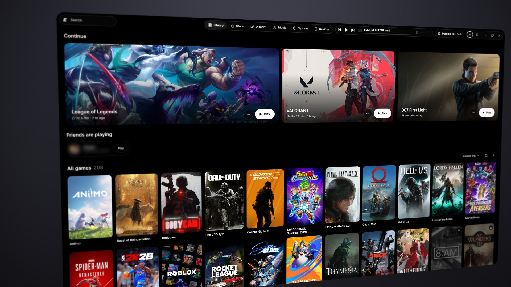

## Download

| File | Version | SHA-256 |
| --- | --- | --- |
| [ExoLauncher-Setup.exe](https://github.com/UhhErix/ExoLauncher/releases/download/v3.20.0/ExoLauncher-Setup.exe) | 3.20.0 | `a4b08421ee073a1211a11c5d393df36edcd462afc4b32200d8badc78eff5be1e` |

**Requirements:** Windows 11 x64. Installs for your Windows user only, in `%LOCALAPPDATA%\ExoLauncher\app`, with no administrator rights.

**Check your download.** The installer isn't code-signed yet, so Windows SmartScreen may warn the first time (choose **More info**, then **Run anyway**). Before you run it, check that its hash matches the one above and on the [release page](https://github.com/UhhErix/ExoLauncher/releases/tag/v3.20.0):

```powershell
Get-FileHash .\ExoLauncher-Setup.exe -Algorithm SHA256
```

Or let PowerShell do the check for you. This script downloads the latest release, stops if the SHA-256 doesn't match the one GitHub lists for it, and then installs ([read the script first](https://github.com/UhhErix/ExoLauncher/blob/main/Install-ExoLauncher.ps1)):

```powershell
irm https://raw.githubusercontent.com/UhhErix/ExoLauncher/main/Install-ExoLauncher.ps1 | iex
```

> [!WARNING]
> **Two features carry a risk to your accounts. Read this before you use them.**
> - **Discord:** Discord's terms don't allow third-party clients. Exo's Discord room is its own client, so signing in to it is at your own risk.
> - **Anti-cheat:** changing upscaler files in a game with anti-cheat can get that account banned. Exo asks you for each such game before it changes anything, and never touches Riot games.

## Install

1. Download **ExoLauncher-Setup.exe** (above) and check its hash.
2. Run it, choose **Install**, then **Launch Exo**. First run walks you through your game stores, music, Discord and captures, offers to remove the apps Exo replaces, and ends with Best settings for this PC.
3. Exo finds your games and starts your music service out of sight. When a new version is out, Exo asks once as it opens, before you start, never in the middle of a game; **Settings > About** shows it too.

## What it does

A gaming PC usually runs Steam, the Epic Games Launcher, Riot Client, Discord, Spotify, a capture app and a mouse app, each with its own window, tray icon, updater and built-in browser. Exo puts them in one window and keeps the apps it depends on quiet in the background.

- **One library for every store:** Steam, Epic, GOG, Amazon, Riot, Xbox, EA, Ubisoft, Battle.net, Rockstar, itch.io, Minecraft, Roblox, Paradox, Wargaming and any game you add yourself. One grid, one search, one sort, with play time, last launched, sizes and achievements. Play, install, update and uninstall from the same page.
- **Discord without the Discord app:** Exo has its own Discord client.
- **Your music in one player:** Spotify, Apple Music and YouTube Music, with lyrics, Jam and Friend activity for Spotify, and a mini player in the top bar.
- **Game-aware:** downloads pause while you play, your mouse switches to the game's profile, instant replay runs, and Exo goes quiet behind the game.
- **Better games:** DLSS, FSR (FSR 4 included) and XeSS updated with the vendors' own signed files, with one-click restore; NVIDIA driver profiles; and shader precompiling to cut stutter.
- **Lighter in the background:**
  - Spotify starts hidden behind Exo and stops drawing while you can't see it.
  - A paused music player is frozen until you reach for it.
  - Store apps running in the background stay hidden and out of the tray. While Steam, Epic, EA, Ubisoft, GOG Galaxy or Battle.net sits hidden, Exo hands the memory its built-in browser holds back to Windows. On a test PC, Steam's browser helpers went from about 280 MB to under 80 MB.
  - Behind a game, Exo drops to low priority and Windows efficiency mode, and its rooms stop all work.
- **Quick:** rooms switch instantly because their apps are already running. In our testing, Store pages open in about half a second, and the Library is ready about half a second after the window appears (on a 108-game library).
- **Your look:** Light, Dark or Void (pure black, for OLED), or matched to Windows. The same layout at 1080p, 1440p and 4K, only sharper.
- **No account, no ads, no analytics, no telemetry.** Your library, settings and keys stay on your PC.

## The rooms

### Library

Every game you own, from every store, in one grid, plus the games your Steam Family shares; a game that isn't installed carries a small mark. **Continue** keeps the games you're playing one click from Play, and **Friends are playing** shows the games your Discord friends are in right now. Sort by name, installed first, last launched, time played, size or store. Refresh reads every store again, measures sizes, reads achievements and fetches art.

- **Folders:** + > New folder, name it, pick a color and tick its games. Right-click a game to add it to a folder. A folder is also how you keep favorites.
- **Add any game:** + > Add a game picks a game's own .exe; Find a game in a folder finds it for you.
- **More than one account:** switch between Steam accounts, or Riot accounts for League and VALORANT, in Settings > Accounts and keys.

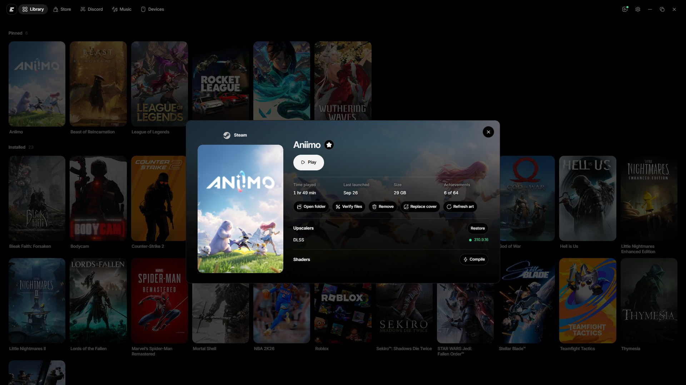

A game's page shows where it's from, time played, last launched, size and achievements, with Play, Uninstall (Remove for a game you added) and Properties. Rows for its upscalers and shaders open their PC page, and HDR sets whether the game plays in HDR.

**Properties** has the choices that are yours: launch options, language, betas, checking files, moving the game to another drive, and DLC and optional content (such as a high-resolution texture pack), with the space each takes or frees shown first. Artwork replaces the cover with your own picture. What has one right answer Exo sets for each Steam game itself: cloud saves on, updates kept, the Steam overlay only where the game needs it (Steam purchases, playing online with friends, Remote Play Together, Steam Input) and Steam Input from the game's controller support.

### PC

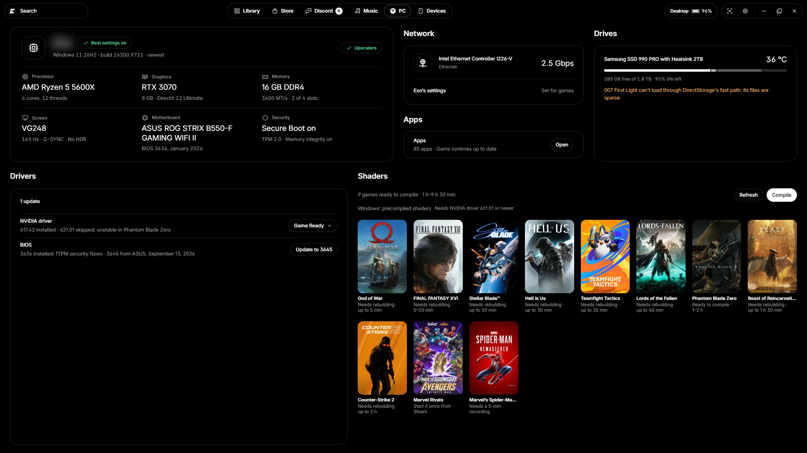

One page: This PC with its parts, Best settings in green beside its name (or what's still missing in red) and a check for Upscalers, then Network, Drives (which clean themselves), Apps (the uninstaller and game runtimes), every driver in one list, and Shaders. Display opens as a floating menu, with your graphics card's control panel.

- **Driver and profile:** NVIDIA's newest driver for your card, checked at most once an hour and installed clean, driver only, with no NVIDIA app, telemetry, PhysX or HDMI audio (AMD's or Intel's newest on Radeon or Intel graphics). Exo's NVIDIA driver profile for the lowest latency, with or without G-SYNC.
- **HDR:** on only while a game with real HDR runs, with SDR drawn at gamma 2.2 so blacks stay black.
- **Display:** the refresh rates and colors your screen really takes, scaling and **Override the scaling set by games**, color from brightness to hue, and RTX Video Super Resolution and HDR. A change applies and stays.

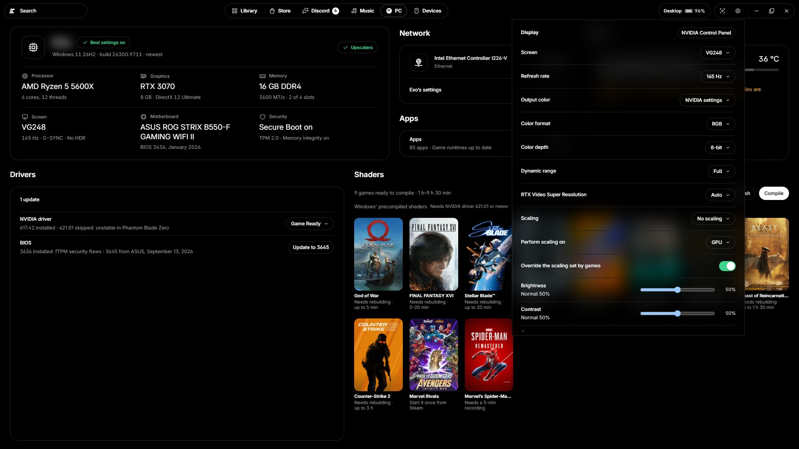

### Upscalers

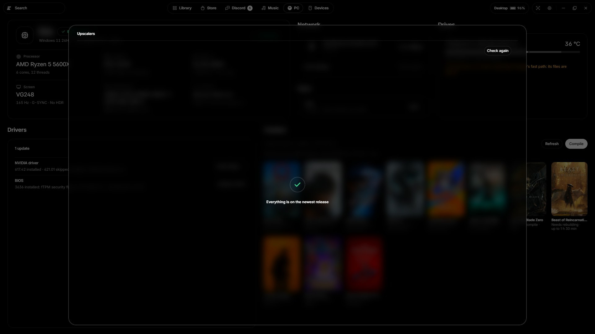

PC > Upscalers lists every installed game that can get newer DLSS, FSR or XeSS and updates them all at once.

- **New releases:** when Exo opens it checks NVIDIA's, AMD's and Intel's own releases, so a new DLSS, FSR 4 or XeSS reaches your games without an Exo update.
- **Files:** every file is the vendor's own, checked for its signature, exact version and checksum before it goes in. Restore puts the game's originals back byte for byte. A running game waits until you close it.
- **Anti-cheat:** a game with anti-cheat changes only after you allow it for that game, at your own risk. Riot games are never changed.

### Shaders

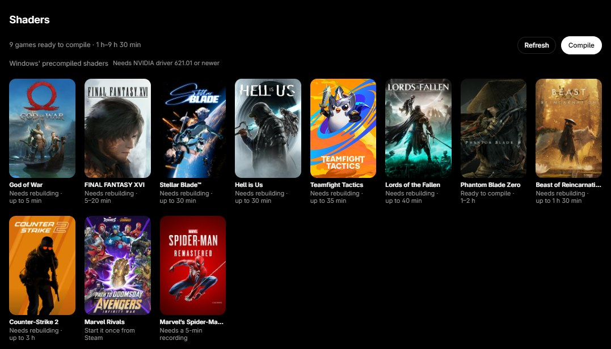

Exo Shaders precompiles each game's shaders for your current graphics driver, so a game doesn't stutter the first time it meets a new effect. It shows which games are compiled, keeps a queue, and skips a game Windows already compiled for your card. After a driver update, Refresh shows the games to compile again. It runs only when you press Compile or Refresh, keeps its memory use down while it works, and stops soon after.

### Store

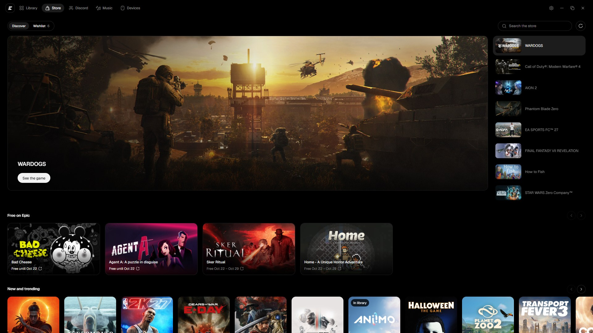

Steam's new and upcoming games, new and trending, most anticipated, top sellers, sales and most wishlisted, shelves picked from what you play, and search, with prices in your currency and review scores. Wishlist a game and Exo tells you when it goes on sale.

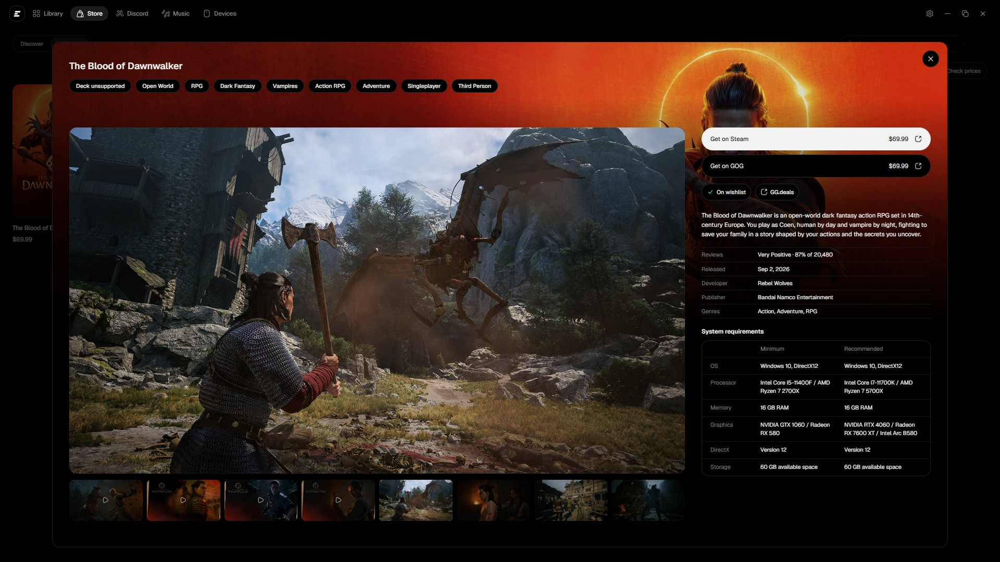

Every game's page has the same one-screen layout: trailers and screenshots with details on the left; the logo, each official store's price, the description and system requirements on the right, with your PC's parts beside them and a check or a cross. Get opens the store's own app. Prices come from official stores only.

### Discord

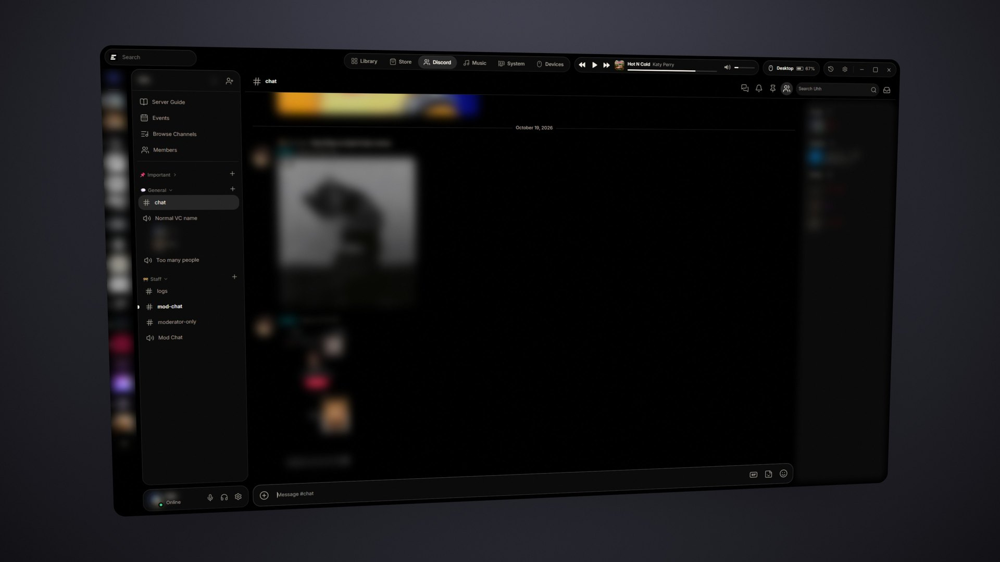

> [!NOTE]
> Discord's terms don't allow third-party clients. Using this room is at your own risk.

Exo's own Discord client, laid out like Discord: servers, DMs, Friends, forums, polls, app commands, GIFs, stickers and emoji with favorites, full profiles, Discord's Shop, group DMs, bookmarks and reminders, message requests, and moderation and every page of Server Settings where you have permission. You sign in with a QR code from Discord's phone app, never a password. Drag servers to reorder them or make folders, and an invite link joins the server right here. Notifications follow Discord's own rules and clear when you read the chat anywhere, and the unread count shows on the Discord tab and Exo's taskbar button. The names, messages and pictures in this picture are blurred for privacy.

**Calls** are end-to-end encrypted, with camera and Go Live screen share, in servers and DMs. Noise suppression removes fans, keys and room noise from your voice; echo cancellation lets you call on speakers; and Noise Suppression for Others can clean up everyone else's voice too.

### Music

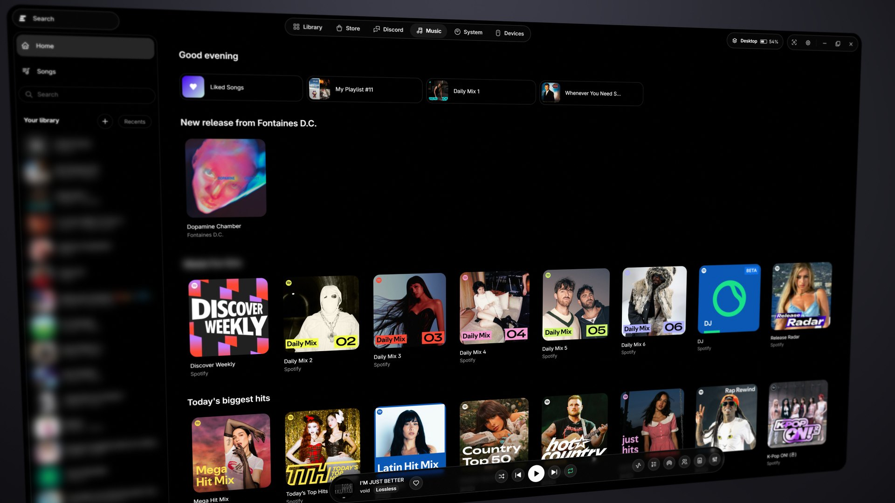

Exo's own player for Spotify, Apple Music and YouTube Music:

- **Browsing:** your library down the left, Songs for every song you saved, Home, search, playlists, albums, artists and podcasts.
- **Playing:** a queue you can jump around in, lyrics that follow the song, and the mini player in the top bar.
- **Spotify extras:** Jam with friends, see what they're listening to, and pick the device that plays. A Spotify link sent to you in Discord opens right here, and a Jam link joins it.

### Captures

The Capture button in the top bar, or its keys, saves an instant replay of the last minutes, starts or stops a recording, or snips any part of your screen. Exo Capture records on your graphics card's own encoder (NVIDIA, AMD or Intel).

- **Captures:** every replay, recording and snip, sorted by game, with a player, trim, favorites, a copy sized for Discord and Send to Discord.
- **Space:** a storage limit and an age you set; favorites are always kept.

### Devices

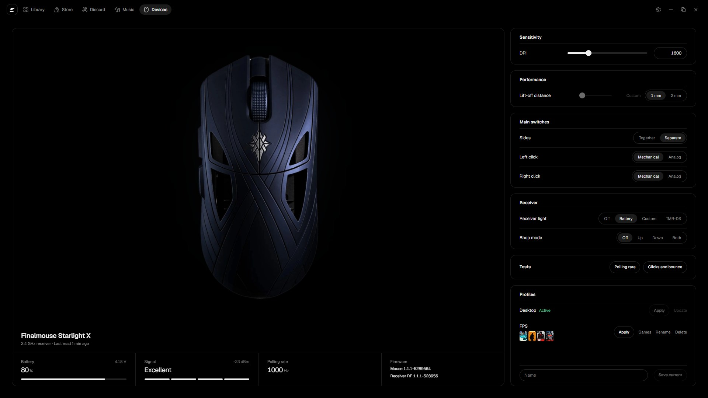

Devices shows what you plug in, each with the maker's own picture of that model: your mouse, keyboard, what you listen on and your controller.

- **Headphones:** Windows can't tell which pair is on the jack, so you pick yours from the hundreds Lucid knows. Its page holds Lucid (it switches your headphones' EQ when your device or game changes), Game Mode and Night Shift. Lucid is made by [tekkusai](https://github.com/tekkusai/Lucid).
- **Controllers:** a DualSense, DualSense Edge, DualShock 4, Xbox controller or other gamepad opens the Controller Lab: live sticks and triggers, a stick test and its measured polling rate. A DualSense or Edge calibrates its sticks with its own routine, an Edge's four profiles (stick curves, trigger ranges, back buttons) are edited here and stored in the controller, and each Steam game gets Steam Input only where it needs it: one that reads the controller itself skips it.
- **USB ports:** each device's page says which USB it's on, and Devices says when a device would gain from one of the processor's own ports.
- **Keyboards** show as Coming soon until Exo sets them up.

Your mouse's page is **Exo Mouse**, which talks to your mouse directly over USB, with no vendor app, driver or account: battery, signal and firmware; DPI, polling rate, lift-off, buttons and lighting (only what your mouse has); and profiles that switch on when a linked game starts. It works with the mice OpenMouse supports, wired or on their receiver. Built on [OpenMouse](https://github.com/OpenMouse-Project/openmouse), made by [snekxs](https://github.com/snekxs), with their permission.

### Settings

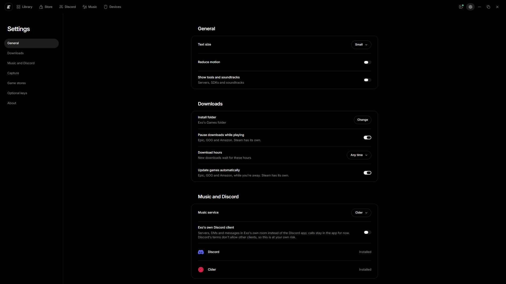

One page that floats over the room you were in: appearance (Match Windows, Light, Dark or Void), Glass, text size and reduce motion; download hours and the install folder; your music service; your game stores, their accounts and notifications, and Steam's offline mode; dictation (a mic in Exo's text boxes that types what you say, on this PC); optional keys and updates.

## How it works

Exo is a native Windows app (WinUI 3 and .NET) with its interface drawn in an embedded Microsoft Edge WebView2.

- **Stores:** Exo reads what each store already keeps on your PC (Steam's library and manifests, Riot Client's records, the Xbox app's game configs and more) and launches through each store's own client. Epic, GOG and Amazon run through the open-source tools Legendary, gogdl and Nile, and a game Epic's own launcher installed updates in that launcher, out of sight. You sign in on each store's own page. Downloads, ownership, DRM and anti-cheat stay the stores' job.
- **Discord:** Exo's own client. No Discord app to install.
- **Music:** each service plays the music itself, hidden behind Exo: Spotify's desktop app, and Apple Music's and YouTube Music's web players. Exo drives them through their own interfaces and draws what you see, so your account, downloads and sound quality are the service's own.
- **Captures, Devices and Shaders:** separate programs that ship with Exo and talk to it only through messages (Exo Mouse and Exo Shaders are open source). Exo Capture records on the graphics card's encoder, Exo Mouse talks to your mouse over USB, and Exo Shaders precompiles shaders for your driver.
- **Memory:** a room you can't see stops drawing, has its memory trimmed and runs in efficiency mode. Nothing a game, download or call needs is ever closed.

## Privacy and safety

- **No Exo account, no ads, no analytics, no telemetry.** Exo's own servers send its updates, and its call relay passes what you play between the Exo apps in one Discord call, end-to-end encrypted so it can't read it. Your library, settings, covers, play time and keys stay in `%LocalAppData%\ExoLauncher`, and your captures in your Videos folder. Optional keys and your Discord sign-in are encrypted with Windows.
- **Your sign-ins stay with each service.** You sign in on the store's or service's own page or window, and to Discord with your phone. Exo never sees your passwords.
- **What leaves your PC** is only what a feature needs: store lookups, cover art, Store pages, prices, driver and upscaler releases, the update check, and what you do in Discord and your music service. The [privacy policy](PRIVACY.md) lists every destination and what is sent.
- **Account risks:** see the warning under [Download](#download).
- **Security problems:** [SECURITY.md](https://github.com/UhhErix/ExoLauncher/blob/main/SECURITY.md) says how to report them.

## License

Exo Launcher is **free for personal use; from 3.18.0 its source isn't published**. The full terms are in [LICENSE](LICENSE); this is a plain summary, and LICENSE wins if they differ.

| You can | You need written permission to |
| --- | --- |
| Download, install and run the official app on your devices | Copy, redistribute, resell or rebrand the app; reverse engineer it |
| Send bugs and ideas as issues ([CONTRIBUTING.md](CONTRIBUTING.md)) | Use the Exo names or logo ([TRADEMARKS.md](TRADEMARKS.md)) |

To ask for permission, [open an issue](https://github.com/UhhErix/ExoLauncher/issues). The app is provided as is, without warranty. Versions released earlier under the MIT license keep their MIT permissions.

**Open-source parts that ship with Exo** keep their own licenses, and their source is public:

- [Exo Mouse](https://github.com/UhhErix/exo-mouse) (AGPL-3.0-or-later), built on OpenMouse by snekxs.
- OBS Studio's game capture hook (GPL-2.0-or-later), unchanged, which Exo Capture runs for a game in exclusive full screen. Exo Capture itself is Exo's own; [its versions up to 3.17.1](https://github.com/UhhErix/exo-capture) are GPL-3.0-or-later.
- [Exo Shaders](https://github.com/UhhErix/exo-shaders) (GPL-3.0-or-later), based on SCSKiller.
- [Exo Shield](https://github.com/UhhErix/exo-shield) (GPL-3.0), Exo's blocker, made from uBlock Origin Lite and HaGeZi's Multi PRO list, and SponsorBlock (GPL-3.0), in the music players' browser.

Every bundled library and tool is listed in [Third-party notices](THIRD_PARTY_NOTICES.md).

**Not affiliated.** Exo Launcher is independent and not affiliated with or endorsed by Valve, Epic Games, GOG, Riot Games, Microsoft, EA, Ubisoft, Blizzard, Amazon, Discord, Spotify, Apple, Google, NVIDIA, AMD, Intel, OBS Studio or any other company it works with. Their names, logos and game art belong to their owners. Your use of each service stays under that service's own terms.

## Also from Exo

- **[Exo Browser](https://github.com/UhhErix/ExoBrowser)** — private browser with Exo Shield and Exo Vault built in
- **[Exo Cinema](https://github.com/UhhErix/ExoCinema)** — Jellyfin library with a native mpv player (HDR / Dolby Vision)

---

[Help](docs/HELP.md) · [Report an issue](https://github.com/UhhErix/ExoLauncher/issues) · [Support development](https://www.buymeacoffee.com/UhhErix)

© 2026 Erix ([UhhErix](https://github.com/UhhErix)).
