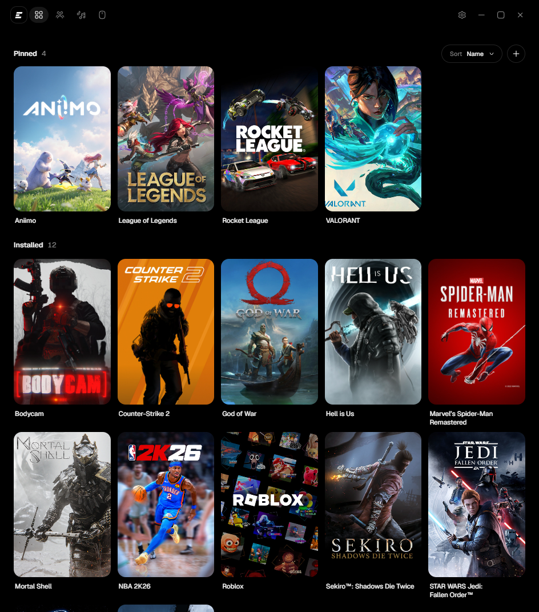
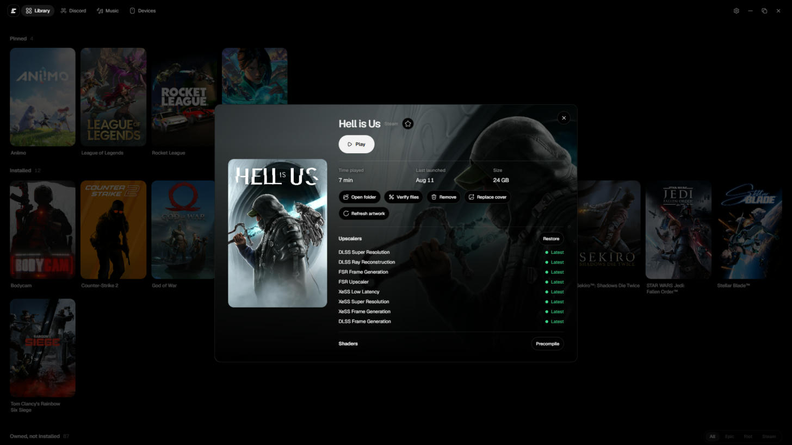
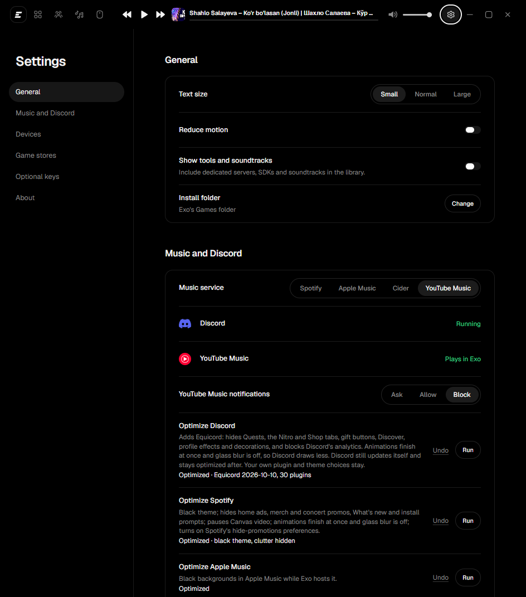

<p align="center"></p>
<h1 align="center">Exo Launcher 3.4.0</h1>
<p align="center"><strong>Your games. Your music. Your space.</strong></p>
<p align="center">A home for your PC gaming life. Bring your libraries together, keep Discord close, and take your music from browsing to playing.</p>
<p align="center"><a href="https://github.com/ImAvgErix/ExoLauncher/releases/latest/download/ExoLauncher-Setup.exe"><strong>Download for Windows 11</strong></a> · <a href="https://github.com/ImAvgErix/ExoLauncher/releases/tag/v3.4.0">3.4.0 release notes</a></p>



## Meet your next launcher

**Your whole session in one place.** A focused library, a full music room, Discord, and your mouse share one desktop app. The interface stays compact; your games get the space.

- **One library, across stores.** Find installed games, pin favorites, search, and open a game for its available Play, Install, or Update action. Steam, Epic, GOG, Riot, and portable games have provider-specific support; additional stores support detected local games.
- **Your whole Steam library, no key needed.** Exo asks the Steam client you're signed in to which games you own, so installed games show as owned and games you haven't installed appear ready to install. If Steam has a remembered sign-in but isn't running, Exo starts it quietly once. A Steam Web API key is optional.
- **Setup in two short steps.** Your game stores, then Music and Discord, with no keys to paste and no account to make.
- **Settings, rebuilt.** One column with a section list: General, Downloads, Music and Discord, Game stores, Optional keys, and About. Every row says what it does, and optional keys you paste (Steam, itch.io, SteamGridDB) save.
- **Keep the music going.** Choose Spotify, Apple Music, Cider, or YouTube Music, use the mini player, and keep playback running while moving between rooms. Provider accounts and subscriptions still apply.
- **Discord, within reach.** The Discord room hosts your installed Discord desktop app inside Exo, left exactly as Discord ships it. Voice, video, and screen sharing are Discord's own. Run **Optimize Discord** in Settings if you want Exo to add Equicord; Spotify, Apple Music, Cider and YouTube Music have their own Optimize rows.
- **Your mouse, in its own room.** The Devices room is Exo Mouse: DPI, polling rate, lift-off, buttons, lighting, sleep and onboard profiles for every mouse [OpenMouse](https://github.com/OpenMouse-Project) supports, showing only what your mouse has. It needs no other app, no vendor software and no driver. Every change is written to the mouse and read back.
- **Epic and GOG sign-in completes**, including sign-in with Google, Xbox, PlayStation, Steam, and the other providers those stores offer.
- **Quiet behind your game.** A hidden Discord stops redrawing, hosted apps behind a closed room run in Windows efficiency mode, Exo uses about 40 MB while minimized, and scrolling the library costs about half the CPU it did.
- **Make it yours.** Replace game artwork with covers you choose; they stay on your PC.

## Four rooms. One session.

| Room | What you can do |
| --- | --- |
| Library | Browse your games, pin favorites, and use supported store actions. |
| Discord | Use your installed Discord desktop app inside Exo. |
| Music | Open your music service and control playback from the mini player. |
| Devices | Tune your mouse with Exo Mouse: DPI, polling rate, buttons, lighting and more. |

<p align="center"> </p>

Settings keeps game stores, downloads, Music and Discord, optional keys, and game runtimes together.

## Built around your PC

Exo has no account of its own. Your library, settings, artwork overrides, paths, playtime, and optional keys stay on your PC. Store, Discord and music features use those services' own accounts.

Exo coordinates supported store clients and helpers. Vendors still handle ownership, authentication, downloads, DRM, and anti-cheat. Support varies by store; see the [feature matrix](docs/SUPPORT_MATRIX.md) and [vendor notes](docs/VENDORS.md).

**Upscalers:** optional, and only for files a game already ships. Exo puts in official NVIDIA, AMD and Intel files pinned by SHA-256, saves the originals for a byte-checked Restore, and never changes games with anti-cheat unless you allow it for that game, at your own risk. Riot games are never changed.

**Shaders:** [SCSKiller](https://github.com/BlueHeisenberg/SCSKiller), the free shader precompiler, runs inside Exo: **Library > Shaders** shows SCSKiller's own app at a large size without its title bar, with everything it does (compiling, recordings, Before and after, official and community recordings, its settings, updates and Patreon builds). It keeps compiling from its tray after Exo closes. Each game's sheet says Compiled when SCSKiller compiled it for your current graphics driver, or offers one button that opens Shaders. Exo runs no part of SCSKiller itself.

**No Exo account.** Exo 3.4 removed the optional Exo account. Nothing in the app signs in to Exo, and the first start after updating deletes the sign-in an earlier version saved on this PC. See the [privacy policy](PRIVACY.md) for what that means for an account you made before.

Read the [privacy policy](PRIVACY.md).

The application source is private. Public downloads and documentation are maintained in [ImAvgErix/ExoLauncher](https://github.com/ImAvgErix/ExoLauncher). Future original changes are proprietary under [LICENSE](LICENSE); previously MIT-licensed releases retain their applicable permissions. Exo Mouse, the Devices room, is a separate program under AGPL-3.0-or-later, built on OpenMouse's protocol library; its source is public at [ImAvgErix/exo-mouse](https://github.com/ImAvgErix/exo-mouse), updated with each release that ships it. Exo Launcher is not covered by the AGPL.

## Get Exo 3.4

1. Download **[ExoLauncher-Setup.exe](https://github.com/ImAvgErix/ExoLauncher/releases/latest/download/ExoLauncher-Setup.exe)**.
2. Run the installer, then open Exo.
3. Let Exo find the games and clients on your PC.

**Windows 11 x64.** Installs per user to `%LOCALAPPDATA%\ExoLauncher\app`. The installer is unsigned, so Windows SmartScreen may display a warning.

## Build locally (private source)

WinUI 3 + React/WebView2, with the .NET SDK pinned in [global.json](global.json) and Node 24. `VERSION` supplies the native app version; the private UI package mirrors it.

```powershell
cd ui
npm ci
cd ..\mouse
npm ci
cd ..
dotnet build ExoLauncher\ExoLauncher.csproj -c Release -p:Platform=x64
pwsh -File Run-ExoLauncher.ps1
```

See [architecture](ARCHITECTURE.md), [supported features and validation limits](docs/SUPPORT_MATRIX.md), and [cache policy](docs/CACHE_POLICY.md).

[Report an issue](https://github.com/ImAvgErix/ExoLauncher/issues) · [Support development](https://www.buymeacoffee.com/UhhErix) · [Changelog](CHANGELOG.md)

Exo Launcher, [Exo OS](https://github.com/ImAvgErix/ExoOS), and [Exo Browser](https://github.com/ImAvgErix/ExoBrowser) are separate products.

© 2026 Erix ([ImAvgErix](https://github.com/ImAvgErix)).
